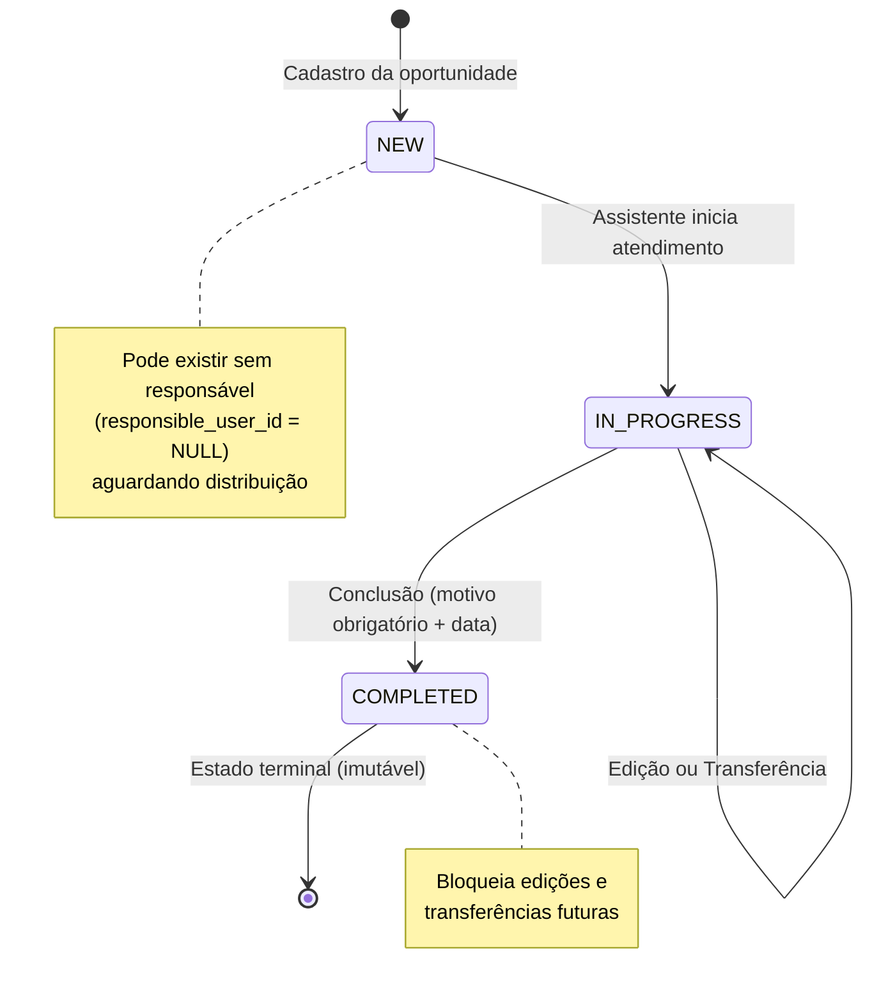
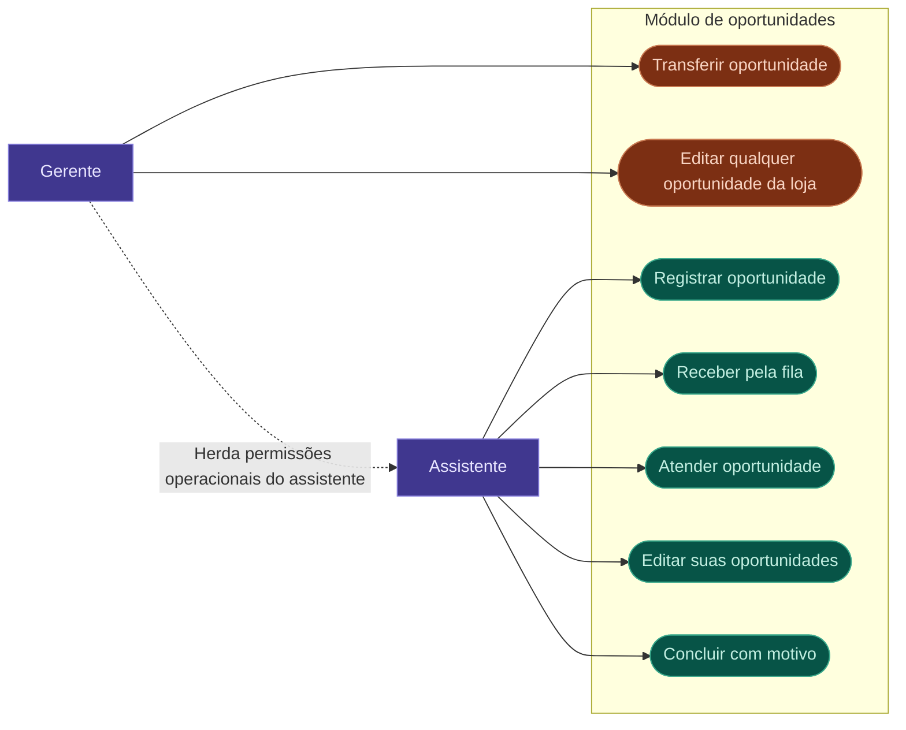
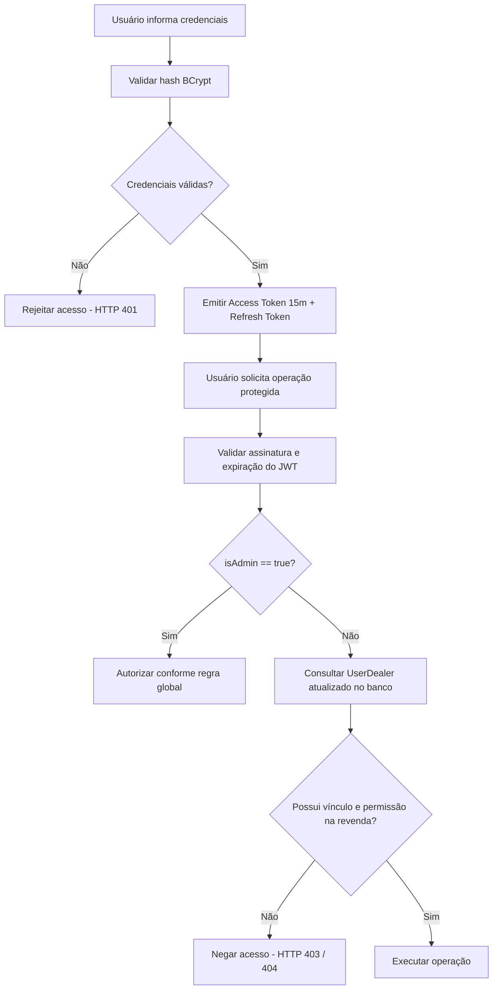
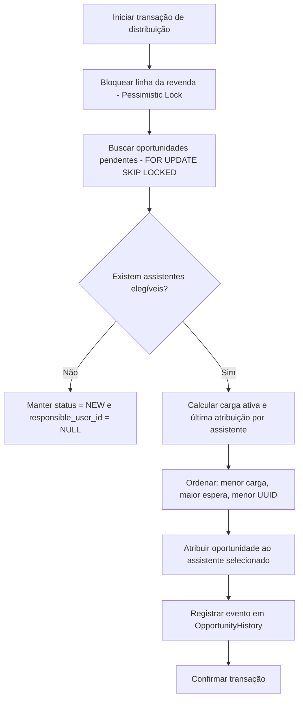
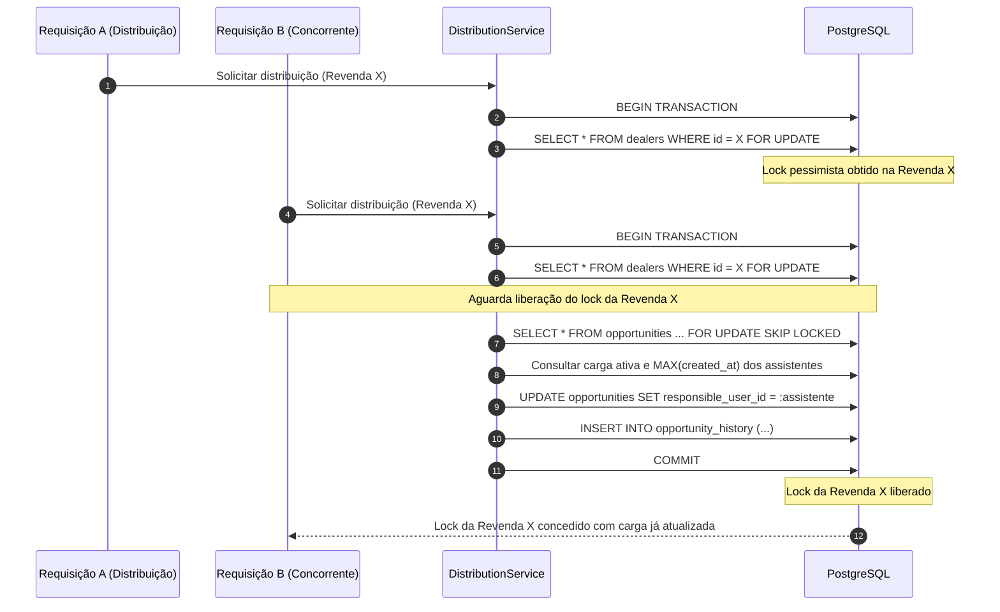
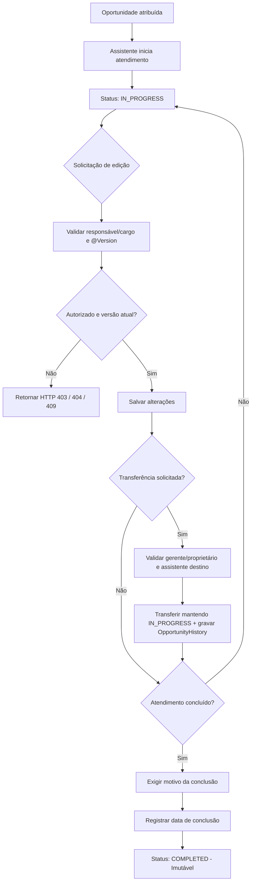
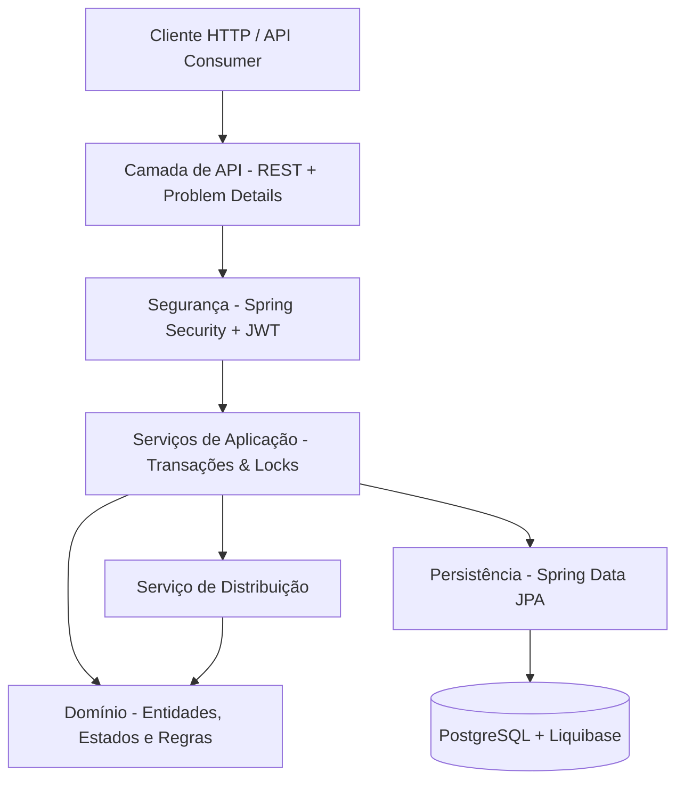
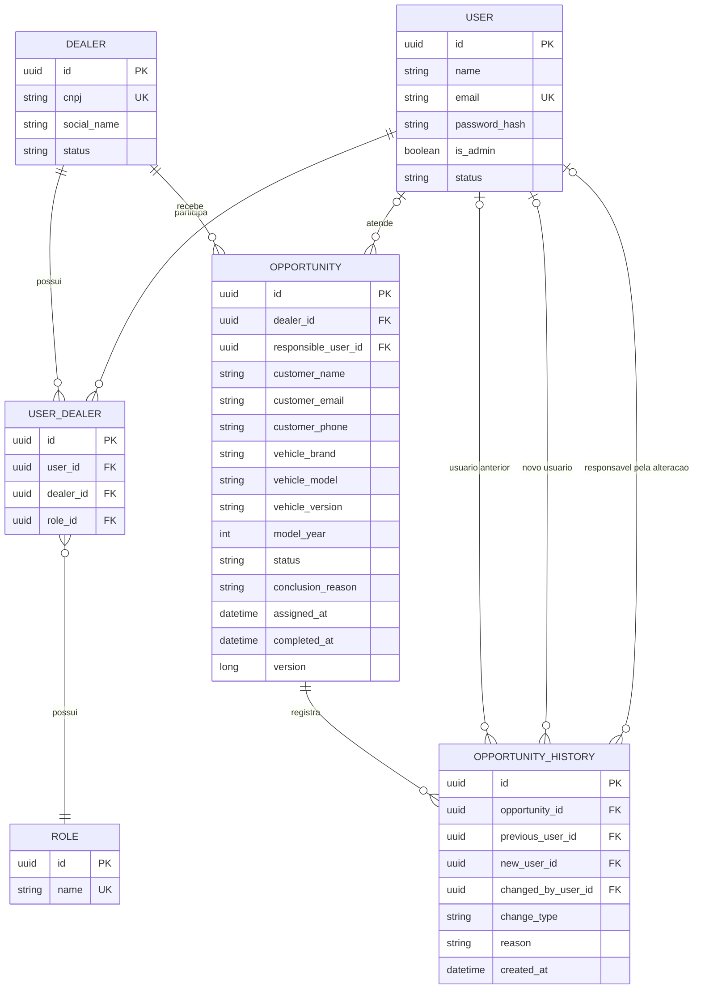

<div align="center">

# RevendaFlow — Gestão de Revendas

Uma solução backend para gestão de revendas automotivas, usuários, permissões e oportunidades comerciais.


</div>

---

## Sumário

* [1. Sobre o projeto](#1-sobre-o-projeto)
* [2. Escopo funcional](#2-escopo-funcional)
* [3. Perfis e permissões](#3-perfis-e-permissões)
* [4. Fluxos de negócio e regras técnicas](#4-fluxos-de-negócio-e-regras-técnicas)
* [5. Arquitetura e decisões técnicas](#5-arquitetura-e-decisões-técnicas)
* [6. Modelo conceitual de domínio](#6-modelo-conceitual-de-domínio)
* [7. Regras de negócio](#7-regras-de-negócio)
* [8. Stack tecnológica](#8-stack-tecnológica)
* [9. Configuração e execução](#9-configuração-e-execução)
* [10. API e padronização de erros](#10-api-e-padronização-de-erros)
* [11. Observabilidade, auditoria e LGPD](#11-observabilidade-auditoria-e-lgpd)
* [12. Estratégia de testes e cobertura](#12-estratégia-de-testes-e-cobertura)
* [13. Ordem de implementação](#13-ordem-de-implementação)

---

## 1. Sobre o projeto

O **DriveFlow** é uma solução backend destinada à gestão de revendas automotivas, usuários, permissões contextuais e oportunidades comerciais.

A plataforma permite que diferentes revendas operem de forma isolada, com usuários vinculados às lojas e permissões determinadas por seus cargos. Também oferece um fluxo concorrente e determinístico de distribuição automática de oportunidades sem responsável, priorizando assistentes com menor volume de oportunidades em andamento e maior tempo desde a última atribuição.

### Objetivos arquiteturais

Estabelecer uma base técnica consistente priorizando:

* **Segurança e isolamento entre revendas:** segregação estrita de dados e permissões contextuais por loja.
* **Integridade e consistência dos dados:** restrições no banco relacional, migrations versionadas e transações ACID.
* **Manutenibilidade e evolução da aplicação:** separação clara de responsabilidades e domínio rico.
* **Controle de concorrência:** bloqueios pessimistas na distribuição e controle otimista (`@Version`) nas atualizações.
* **Rastreabilidade das operações:** histórico imutável de atribuições/transferências e trilhas de auditoria administrativa.
* **Qualidade e confiabilidade do código:** testes unitários, de integração com infraestrutura real e metas de cobertura.

> **Estado atual:** a especificação funcional e as decisões técnicas/arquiteturais iniciais já estão definidas para orientar a implementação do projeto.

## 2. Escopo funcional

### 2.1 Gestão de revendas

Cada revenda possui:

| Campo | Regra |
| ----- | ----- |
| Código identificador | Único (UUID) |
| CNPJ | Obrigatório, válido e único |
| Nome social | Informação cadastral da revenda |

### 2.2 Gestão de usuários e perfis

A base de usuários contém:

* Código identificador (UUID);
* Nome;
* E-mail único;
* Senha (armazenada exclusivamente via hash BCrypt);
* Indicador de administrador global (`isAdmin`).

Um usuário poderá possuir vínculo com uma ou mais lojas, com um cargo associado a cada vínculo. Os cargos previstos são:

* **Administrador (`isAdmin = true`):** possui abrangência global e pode executar ações administrativas em todas as revendas, sem necessidade de vínculo em `UserDealer`.
* **Proprietário:** possui permissões de gestão na própria loja, conforme as regras da solução.
* **Gerente:** pode cadastrar usuários para sua loja, transferir oportunidades e editar oportunidades da própria loja.
* **Assistente:** realiza o atendimento das oportunidades atribuídas a ele.

O cadastro de usuários é permitido a administradores e, no contexto da própria loja, a proprietários e gerentes. A manutenção de perfis é restrita a administradores e proprietários.

### 2.3 Gestão de oportunidades

Cada revenda mantém suas próprias oportunidades comerciais. Cada oportunidade contém:

**Identificação e acompanhamento**

* Código identificador único (UUID);
* Versão de controle otimista (`version`);
* Status (`NEW`, `IN_PROGRESS`, `COMPLETED`);
* Responsável pelo atendimento, quando atribuído;
* Data de atribuição;
* Data de conclusão, quando concluída;
* Motivo da conclusão, obrigatório ao concluir.

**Dados do cliente**

* Nome;
* E-mail;
* Telefone.

**Dados do veículo de interesse**

* Marca;
* Modelo;
* Versão;
* Ano modelo.

#### Máquina de estados das oportunidades

As transições de estado são explícitas e validadas diretamente na camada de domínio:



| Status | Descrição |
| ----- | ----- |
| `NEW` | Oportunidade cadastrada (estado inicial). |
| `IN_PROGRESS` | Oportunidade em atendimento por um usuário da revenda. |
| `COMPLETED` | Oportunidade concluída (estado terminal). |

**Matriz de transições permitidas:**

| Estado atual | Próximo estado | Permitido |
| ----- | ----- | ----- |
| `NEW` | `IN_PROGRESS` | Sim |
| `NEW` | `COMPLETED` | Não |
| `IN_PROGRESS` | `COMPLETED` | Sim |
| `COMPLETED` | `IN_PROGRESS` | Não |
| `COMPLETED` | `NEW` | Não |

**Regras adicionais do ciclo de vida:**

* A conclusão exige um motivo obrigatório e registra a data de finalização.
* Oportunidades em `COMPLETED` são imutáveis: não podem ser editadas nem transferidas.
* A transferência de responsável mantém o status em `IN_PROGRESS`.

## 3. Perfis e permissões

A autorização considera simultaneamente o perfil do usuário e seu vínculo contextual com a revenda (`UserDealer`). O administrador global (`isAdmin = true`) possui abrangência global; os demais perfis atuam estritamente no contexto da loja à qual estão associados.

| Operação | Administrador | Proprietário | Gerente | Assistente |
| ----- | ----- | ----- | ----- | ----- |
| Executar ações em todas as revendas | Sim | Não | Não | Não |
| Cadastrar usuários | Sim | Sim, na própria loja | Sim, na própria loja | Não |
| Manter/editar perfis | Sim | Sim, na própria loja | Não | Não |
| Acessar loja sem vínculo | Sim | Não | Não | Não |
| Transferir oportunidades da loja | Sim, global | Sim | Sim | Não |
| Editar qualquer oportunidade da loja | Sim, global | Sim | Sim | Não |
| Registrar oportunidade | Sim | Sim | Sim | Sim |
| Receber oportunidade pela fila | Conforme regra de distribuição | Conforme regra de distribuição | Conforme regra de distribuição | Sim |
| Atender oportunidade | Conforme acesso | Conforme acesso | Conforme acesso | Sim, quando atribuída |
| Editar oportunidade própria/atribuída | Sim | Sim | Sim | Sim |
| Concluir oportunidade com motivo | Sim | Sim | Sim | Sim, quando atribuída |

> **Hierarquia de permissões no módulo de oportunidades:** o gerente herda as permissões operacionais do assistente. Além delas, possui permissões exclusivas de transferir oportunidades e editar qualquer oportunidade da sua loja. Proprietário e administrador seguem as regras de acesso superiores definidas na solução.

### 3.1 Diagrama de permissões — oportunidades



**Legenda:**

* Coral: permissões exclusivas do gerente e cargos superiores.
* Verde: permissões operacionais do assistente, herdadas pelo gerente.
* Seta tracejada: indica a herança do conjunto de permissões do assistente pelo gerente.

### 3.2 Regras de autorização por oportunidade

* **Assistente:** pode editar somente oportunidades atribuídas a ele.
* **Gerente:** pode editar qualquer oportunidade da própria loja e transferi-las para outro assistente elegível da loja, além de executar todas as operações operacionais do assistente.
* **Proprietário:** possui permissões de gestão da loja e acesso total às oportunidades da sua unidade.
* **Administrador (`isAdmin = true`):** possui acesso global e pode executar ações em todas as revendas.
* **Isolamento multi-revenda:** recursos pertencentes a outras revendas retornam `HTTP 404` para evitar revelar sua existência.

## 4. Fluxos de negócio e regras técnicas

### 4.1 Autenticação e autorização



### 4.2 Cadastro e distribuição automática de oportunidades

Oportunidades sem responsável são distribuídas entre os assistentes elegíveis da loja por meio de **balanceamento por carga de trabalho e tempo desde a última atribuição**.



#### Fluxo de concorrência na distribuição (Sequência)



#### Critérios de seleção e desempate

1. **Menor carga de trabalho:** menor quantidade de oportunidades atribuídas ao assistente naquela revenda cujo status seja diferente de `COMPLETED` (inclui oportunidades `NEW` já atribuídas).
2. **Maior tempo de espera:** maior tempo decorrido desde a última atribuição registrada no histórico da revenda (`MAX(created_at)`). Assistentes sem histórico prévio na revenda têm prioridade máxima (`NULLS FIRST`).
3. **Desempate determinístico:** menor `user_id` (UUID) em ordem ascendente.

**Consulta conceitual de carga e ordenação:**

```sql
-- Carga ativa por assistente na revenda
SELECT COUNT(*)
FROM opportunities
WHERE responsible_user_id = :userId
  AND dealer_id = :dealerId
  AND status <> 'COMPLETED';

-- Critério de ordenação para seleção
ORDER BY
    active_opportunities ASC,
    last_assigned_at ASC NULLS FIRST,
    user_id ASC;
```

#### Ausência de assistentes elegíveis

* A oportunidade permanece cadastrada com `status = NEW` e `responsible_user_id = NULL`.
* Não é criado nenhum status adicional de pendência.
* A oportunidade não é descartada nem atribuída automaticamente a gerentes ou proprietários, ficando disponível para distribuição futura.

### 4.3 Atendimento, transferência e conclusão



## 5. Arquitetura e decisões técnicas

### 5.1 Visão geral da arquitetura



### 5.2 Decisões arquiteturais consolidadas

| Tema | Decisão | Diretrizes principais |
| ----- | ----- | ----- |
| **Banco de dados & Migrations** | **PostgreSQL + Liquibase** | Toda alteração estrutural via migration versionada. Hibernate configurado com `ddl-auto: validate` (nunca `update` ou `create`). Uso de constraints e índices diretamente no banco. |
| **Autenticação & Senhas** | **Spring Security + JWT + BCrypt** | Access token de **15 minutos** e refresh token com mecanismo de revogação/invalidação. Senhas armazenadas exclusivamente com hash **BCrypt** e nunca expostas em logs. |
| **Autorização Contextual** | **Consulta em banco por operação** | O JWT identifica o usuário, mas cargos e vínculos (`UserDealer`) são consultados no banco a cada operação protegida para evitar permissões desatualizadas em cache/token. |
| **Concorrência na Distribuição** | **Transação + Lock de Revenda + `SKIP LOCKED`** | Bloqueio pessimista na linha da revenda para serializar distribuições da loja, combinado com `SELECT FOR UPDATE SKIP LOCKED` na fila de oportunidades pendentes. |
| **Concorrência em Edições** | **Controle Otimista (`@Version`)** | Uso de campo `@Version` nas oportunidades. Conflitos de atualização concorrente retornam `HTTP 409 Conflict`. |
| **Histórico & Rastreabilidade** | **Entidade `OpportunityHistory`** | Registro imutável de atribuições iniciais, distribuições automáticas, transferências e ações administrativas, sem sobrescrever registros anteriores. |

### 5.3 Organização de pacotes

```text
src/
└── main/
    ├── java/
    │   └── br/com/driveflow/
    │       ├── config/
    │       ├── security/
    │       ├── dealer/
    │       │   ├── controller/
    │       │   ├── service/
    │       │   ├── domain/
    │       │   └── repository/
    │       ├── user/
    │       │   ├── controller/
    │       │   ├── service/
    │       │   ├── domain/
    │       │   └── repository/
    │       ├── opportunity/
    │       │   ├── controller/
    │       │   ├── service/
    │       │   ├── domain/
    │       │   └── repository/
    │       └── shared/
    └── resources/
        ├── db/changelog/
        └── application.yml
└── test/
    └── java/
```

## 6. Modelo conceitual de domínio



* **`USER_DEALER`:** modela o relacionamento N:N entre usuários e revendas, permitindo que um mesmo usuário exerça cargos distintos em lojas diferentes.
* **`USER.is_admin`:** quando `true`, concede abrangência global administrativa sem exigir vínculo em `USER_DEALER`.
* **`OPPORTUNITY_HISTORY`:** preserva o histórico completo de atribuição inicial, distribuição automática, transferência entre assistentes e alteração administrativa.

## 7. Regras de negócio

| ID | Regra |
| ----- | ----- |
| RN-01 | Cada revenda deve possuir identificador único (UUID). |
| RN-02 | O CNPJ da revenda deve ser válido e único. |
| RN-03 | O e-mail do usuário deve ser único. |
| RN-04 | O usuário só pode acessar lojas às quais esteja vinculado, exceto o administrador global (`isAdmin = true`). |
| RN-05 | O cadastro de usuários é permitido a administradores e, na própria loja, a proprietários e gerentes. |
| RN-06 | A manutenção de perfis é permitida somente a administradores e proprietários. |
| RN-07 | Cada oportunidade deve possuir identificador único e pertencer a uma revenda. |
| RN-08 | O status inicial da oportunidade deve ser `NEW`. |
| RN-09 | A transição de status deve obedecer estritamente à máquina de estados (`NEW` $\rightarrow$ `IN_PROGRESS` $\rightarrow$ `COMPLETED`). |
| RN-10 | A conclusão exige motivo obrigatório, registra a data de finalização e torna a oportunidade imutável para edição e transferência. |
| RN-11 | Toda atribuição ou transferência deve registrar a data e gerar um registro imutável em `OpportunityHistory`. |
| RN-12 | O responsável pode editar a oportunidade atribuída a ele enquanto não estiver concluída. |
| RN-13 | Proprietários e gerentes podem editar e transferir oportunidades não concluídas da sua loja para assistentes elegíveis da mesma loja, mantendo o status `IN_PROGRESS`. |
| RN-14 | A distribuição automática deve priorizar o assistente com menor carga ativa (`status <> 'COMPLETED'`), maior tempo desde a última atribuição (`NULLS FIRST`) e menor UUID. |
| RN-15 | Na ausência de assistentes elegíveis na revenda, a oportunidade permanece em `NEW` sem responsável, sem ser atribuída a gerentes/proprietários. |

## 8. Stack tecnológica

| Componente | Tecnologia | Finalidade |
| ----- | ----- | ----- |
| Linguagem | Java 21 LTS | Linguagem principal |
| Framework | Spring Boot 3.x | Desenvolvimento da aplicação |
| Gerenciador de dependências | Maven | Build e gerenciamento de dependências |
| Banco de dados | PostgreSQL | Persistência relacional e controle de concorrência |
| Versionamento do schema | Liquibase | Controle de migrations |
| ORM | Spring Data JPA / Hibernate | Persistência e mapeamento objeto-relacional |
| Segurança | Spring Security | Autenticação e autorização |
| Tokens | JWT | Autenticação stateless das requisições |
| Documentação API | Springdoc OpenAPI / Swagger | Documentação interativa dos endpoints |
| Containerização | Docker | Empacotamento da aplicação |
| Orquestração local | Docker Compose | Inicialização dos serviços locais |
| Testes unitários | JUnit 5 + Mockito | Validação das regras de negócio |
| Testes de integração | Spring Boot Test + Testcontainers | Testes com PostgreSQL real |
| Cobertura | JaCoCo | Análise de cobertura dos testes |
| Logs | SLF4J + Logback | Registro estruturado de eventos |
| Monitoramento inicial | Spring Boot Actuator | Saúde e informações operacionais |

> **Evolução futura:** **Prometheus** e **Grafana** estão previstos para uma etapa posterior, quando houver necessidade de monitoramento avançado de métricas, desempenho e disponibilidade.

## 9. Configuração e execução

### Pré-requisitos

* JDK 21 LTS;
* Maven 3.9+;
* Docker Engine e Docker Compose.

### Configuração base do Spring (`application.yml`)

```yaml
spring:
  jpa:
    hibernate:
      ddl-auto: validate
  liquibase:
    enabled: true
```

### Variáveis de ambiente

As variáveis de ambiente serão detalhadas conforme os arquivos de configuração forem criados. Um arquivo `.env.example` deverá ser disponibilizado sem credenciais reais.

| Variável | Finalidade | Obrigatória |
| ----- | ----- | ----- |
| `SPRING_DATASOURCE_URL` | URL de conexão JDBC com o PostgreSQL | Sim |
| `SPRING_DATASOURCE_USERNAME` | Usuário do banco de dados | Sim |
| `SPRING_DATASOURCE_PASSWORD` | Senha do banco de dados | Sim |
| `JWT_SECRET` | Chave secreta para assinatura dos tokens JWT | Sim |

**Segurança:** nunca versionar senhas, tokens, chaves ou credenciais reais no repositório.

### Docker Compose

O projeto contará com um `Dockerfile` e um `docker-compose.yml` para orquestrar a aplicação e o banco PostgreSQL localmente (previsto na Etapa 1 de implementação).

## 10. API e padronização de erros

### Padronização de erros — RFC 9457 (Problem Details)

O tratamento global de exceções será centralizado via `@RestControllerAdvice` seguindo o padrão **RFC 9457 — Problem Details for HTTP APIs**.

| Código HTTP | Significado | Regra de aplicação |
| ----- | ----- | ----- |
| `200` | OK | Operação realizada com sucesso. |
| `201` | Created | Recurso criado com sucesso. |
| `204` | No Content | Operação concluída sem corpo de resposta. |
| `400` | Bad Request | Requisição inválida ou erro de validação de payload. |
| `401` | Unauthorized | Usuário não autenticado ou token inválido/expirado. |
| `403` | Forbidden | Usuário autenticado sem permissão (quando não houver necessidade de ocultar o recurso). |
| `404` | Not Found | Recurso inexistente ou pertencente a outra revenda (evita vazar existência). |
| `409` | Conflict | Duplicidade de dados (ex.: CNPJ/e-mail) ou conflito de versão otimista (`@Version`). |
| `422` | Unprocessable Entity | Violação de regra de negócio (ex.: transição de estado inválida, conclusão sem motivo). |
| `500` | Internal Server Error | Erro interno inesperado. |

### Grupos de recursos previstos

| Recurso | Operações previstas no escopo |
| ----- | ----- |
| Autenticação | Login (`access` + `refresh token`), renovação e revogação de sessão |
| Revendas | Cadastro e gestão de revendas |
| Usuários | Cadastro e gestão de usuários |
| Perfis | Associação e manutenção de cargos por revenda (`UserDealer`) |
| Oportunidades | Cadastro, consulta, edição, atendimento, distribuição, transferência, histórico e conclusão |

A documentação detalhada dos contratos será exposta automaticamente via **Springdoc OpenAPI / Swagger**.

## 11. Observabilidade, auditoria e LGPD

### Logs e eventos monitorados

A observabilidade inicial utilizará **SLF4J + Logback** (logs estruturados) e **Spring Boot Actuator**, registrando eventos críticos:

* Autenticação (sucessos, falhas e revogações);
* Cadastro de usuários e revendas;
* Alterações de cargos, vínculos e permissões;
* Criação, distribuição automática, transferências e conclusões de oportunidades;
* Erros e falhas de processamento.

### Trilha de auditoria administrativa

Além de `OpportunityHistory`, o sistema manterá trilha de auditoria para operações administrativas:

* Cadastro e alteração de dados cadastrais de usuários;
* Alteração de cargos e permissões;
* Associação ou remoção de vínculos com revendas.

### Conformidade com a LGPD

Como a plataforma armazena dados pessoais de clientes, as seguintes diretrizes são obrigatórias:

* Mascarar e-mails e telefones nos logs da aplicação;
* Nunca registrar senhas, hashes ou tokens nos logs;
* Evitar exposição desnecessária de dados pessoais nas respostas;
* Restringir o acesso aos registros de auditoria;
* Definir políticas de retenção e expurgo de dados.

## 12. Estratégia de testes e cobertura

A qualidade será garantida por meio de testes automatizados em múltiplas camadas, utilizando banco PostgreSQL real via **Testcontainers**.

### Tipos de testes

| Tipo | Tecnologia | Objetivo |
| ----- | ----- | ----- |
| Unitários | JUnit 5 + Mockito | Validar regras de negócio, máquina de estados e critérios de seleção. |
| Integração | Spring Boot Test + Testcontainers | Validar persistência, migrations Liquibase, transações e locks concorrentes no PostgreSQL. |
| API | MockMvc | Validar contratos HTTP, status RFC 9457, autenticação e autorização contextual. |
| Cobertura | JaCoCo | Medir e acompanhar a cobertura de código. |

### Metas iniciais de qualidade

| Área | Meta de cobertura desejada |
| ----- | ----- |
| Regras de negócio (Domínio) | 90% |
| Serviços de aplicação | 85% |
| Cobertura global | 80% |

> *Nota: as porcentagens acima representam metas de qualidade estabelecidas para o projeto.*

### Cenários prioritários de validação

* Distribuição simultânea (concorrente) de oportunidades na mesma revenda;
* Critérios de desempate na distribuição e priorização de assistentes sem histórico (`NULLS FIRST`);
* Ausência de assistentes elegíveis (manutenção em `NEW` sem responsável);
* Transferência entre assistentes da mesma revenda e bloqueio entre revendas distintas;
* Tentativa de edição ou transferência de oportunidade em status `COMPLETED`;
* Conclusão de oportunidade sem motivo informado;
* Tentativa de acesso a oportunidades de outra revenda (`HTTP 404`);
* Conflito de versão otimista (`@Version`) durante atualização simultânea (`HTTP 409`).

## 13. Ordem de implementação

O desenvolvimento será conduzido de forma incremental nas seguintes etapas:

### Etapa 1 — Fundação da aplicação

* [ ] Criar projeto Spring Boot 3.x com Java 21 LTS e Maven.
* [ ] Configurar PostgreSQL e Liquibase (`ddl-auto: validate`).
* [ ] Estruturar pacotes iniciais (`dealer`, `user`, `opportunity`, `security`, `shared`).
* [ ] Configurar `Dockerfile` e `docker-compose.yml`.
* [ ] Implementar tratamento global de exceções com RFC 9457 (`@RestControllerAdvice`).

### Etapa 2 — Domínio e segurança

* [ ] Implementar entidades `User`, `Dealer`, `Role` e `UserDealer`.
* [ ] Implementar suporte a administrador global (`isAdmin`).
* [ ] Implementar autenticação JWT (access token 15m + refresh token com revogação) e hash BCrypt.
* [ ] Configurar autorização contextual com consulta de vínculos no banco por operação.

### Etapa 3 — Gestão de oportunidades

* [ ] Implementar cadastro, consulta, edição, atendimento e conclusão de oportunidades.
* [ ] Implementar máquina de estados explícita na camada de domínio.
* [ ] Implementar entidade imutável `OpportunityHistory` e trilha de auditoria.

### Etapa 4 — Distribuição automática e concorrência

* [ ] Implementar algoritmo de balanceamento por carga, tempo de espera e UUID.
* [ ] Implementar bloqueio pessimista por revenda e `SELECT FOR UPDATE SKIP LOCKED`.
* [ ] Implementar controle otimista (`@Version`) nas atualizações.
* [ ] Implementar testes de concorrência para validar ausência de condições de corrida.

### Etapa 5 — Qualidade e observabilidade

* [ ] Implementar suíte de testes unitários, de API e de integração com Testcontainers.
* [ ] Configurar relatório e metas de cobertura no JaCoCo.
* [ ] Configurar logs estruturados (com mascaramento LGPD) e Spring Boot Actuator.
* [ ] Documentar endpoints com Springdoc OpenAPI / Swagger e revisar isolamento multi-revenda.

### Etapa futura — Monitoramento avançado

* [ ] Integrar Prometheus e Grafana.
* [ ] Criar dashboards operacionais e monitorar métricas de distribuição e atendimento.


## 14. Evolução arquitetural futura

O RevendaFlow será inicialmente desenvolvido como um monólito modular, priorizando consistência transacional, simplicidade operacional e separação de responsabilidades. A arquitetura inicial não dependerá de infraestrutura de mensageria.

À medida que a aplicação evoluir e surgirem necessidades de processamento assíncrono, desacoplamento entre componentes e integração com serviços externos, poderão ser introduzidos mecanismos de comunicação orientados a eventos.

### 14.1 Arquitetura orientada a eventos

A evolução prevê a adoção gradual de uma arquitetura Event-Driven, utilizando eventos de domínio para representar fatos relevantes ocorridos na aplicação, permitindo que diferentes componentes processem essas informações de forma independente.

Eventos candidatos:

- `OpportunityCreatedEvent`
- `OpportunityAssignedEvent`
- `OpportunityTransferredEvent`
- `OpportunityStartedEvent`
- `OpportunityCompletedEvent`
- `DealerCreatedEvent`
- `UserDealerChangedEvent`

Os eventos poderão ser consumidos por processos de distribuição, notificações, auditoria, métricas e futuras integrações externas, sem acoplamento direto entre os componentes produtores e consumidores.

### 14.2 Mensageria e processamento assíncrono

Como evolução, poderá ser adotado **RabbitMQ** para gerenciamento de filas, roteamento de mensagens e processamento assíncrono.

Possíveis aplicações:

- Processamento assíncrono de distribuição de oportunidades;
- Envio de notificações após atribuições ou transferências;
- Integração com sistemas externos;
- Processamento de eventos operacionais;
- Geração de relatórios e métricas;
- Execução de tarefas que não precisam bloquear a resposta HTTP.

A adoção da mensageria deverá preservar a consistência dos dados, a idempotência dos consumidores, a rastreabilidade dos eventos e o tratamento de falhas de processamento.

### 14.3 Transactional Outbox Pattern

Para garantir maior confiabilidade na publicação de eventos, poderá ser implementado o padrão **Transactional Outbox**.

A persistência da alteração de negócio e do evento a ser publicado ocorrerá na mesma transação do banco de dados. Um processo independente será responsável por identificar eventos pendentes, publicá-los no broker e controlar seu processamento.

Essa abordagem reduz o risco de inconsistência entre a persistência da aplicação e a publicação de mensagens, especialmente em cenários de indisponibilidade do broker.

### 14.4 Confiabilidade e resiliência dos consumidores

A arquitetura de mensageria deverá contemplar:

- Idempotência no processamento de mensagens;
- Política de retry com limites e intervalos definidos;
- Dead Letter Queue (DLQ) para mensagens que não puderem ser processadas;
- Controle de ACK e NACK;
- Registro e rastreabilidade de eventos;
- Monitoramento de filas, consumidores e mensagens pendentes;
- Proteção contra processamento duplicado e concorrente.

### 14.5 Observabilidade e monitoramento avançado

Com o aumento da complexidade operacional, poderão ser adicionados:

- Prometheus para coleta de métricas;
- Grafana para dashboards operacionais;
- Monitoramento de latência e throughput;
- Métricas de distribuição e atendimento;
- Monitoramento de filas, retries e DLQ;
- Alertas para falhas e degradação de serviços.

### 14.6 Roadmap de evolução

| Fase | Evolução | Objetivo |
|---|---|---|
| 1 | Monólito modular e transações | Implementar os fluxos de negócio com consistência e simplicidade |
| 2 | Eventos de domínio | Desacoplar a comunicação lógica entre componentes |
| 3 | Transactional Outbox | Garantir confiabilidade na publicação de eventos |
| 4 | RabbitMQ e consumidores assíncronos | Processamento desacoplado e integração entre componentes |
| 5 | Retry, DLQ e idempotência | Resiliência e confiabilidade do processamento |
| 6 | Prometheus e Grafana | Monitoramento operacional e métricas de desempenho |

A evolução será incremental, orientada pelas necessidades reais do sistema, evitando introduzir complexidade de infraestrutura antes que ela seja necessária.

---

Este README serve como referência técnica e arquitetural oficial do **DriveFlow**. Alterações futuras na arquitetura deverão ser justificadas e documentadas aqui à medida que o projeto evoluir.
